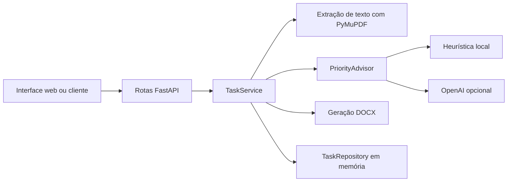

# Micro-API de resumo de PDF

Micro-API em FastAPI com uma interface web para receber PDFs digitais e gerar um resumo em Word (`.docx`) com base em uma sentença orientadora. O projeto mantém metadados das tarefas em memória e oferece um resumidor local, com integração opcional à API da OpenAI.

## Requisitos

- Python 3.12 ou superior.
- Pip.
- Chave da OpenAI opcional. Sem ela, o resumo usa a heurística local.

## Instalação e execução

Crie e ative um ambiente virtual na raiz do projeto.

**Windows PowerShell:**

```powershell
python -m venv .venv
.\.venv\Scripts\Activate.ps1
```

**Linux ou macOS:**

```bash
python3 -m venv .venv
source .venv/bin/activate
```

Instale as dependências e inicie o servidor:

```bash
python -m pip install -r requirements.txt
python -m uvicorn app.main:app --reload
```

A interface fica em `http://127.0.0.1:8000/`, a documentação OpenAPI em `/docs` e a verificação de saúde em `/health`.

## Como usar

1. Selecione um arquivo PDF digital.
2. Escolha **Resumo por sentença orientadora** ou **Resumo do PDF inteiro**.
3. No modo orientado, informe uma sentença que apareça no texto do PDF.
4. Clique em **Gerar resumo em Word** para baixar o arquivo `.docx`.

No modo orientado, a busca da sentença ignora diferenças entre maiúsculas e minúsculas e espaços repetidos. Se a sentença não for encontrada, a API retorna `422` e não gera o documento. No modo de documento inteiro, o resumidor considera o conteúdo de todas as páginas.

## Configuração da IA

A integração com a OpenAI é opcional. Defina as variáveis de ambiente antes de iniciar o servidor:

| Variável | Padrão | Descrição |
| --- | --- | --- |
| `OPENAI_API_KEY` | vazio | Habilita o resumo pela API da OpenAI. Sem chave, usa a heurística local. |
| `OPENAI_MODEL` | `gpt-4o-mini` | Modelo enviado à API. |
| `OPENAI_TIMEOUT_SECONDS` | `20` | Timeout em segundos, limitado pelo código ao intervalo de 1 a 120. |

O projeto não carrega automaticamente arquivos `.env`; defina as variáveis no ambiente. Quando habilitada, a integração envia o texto extraído do PDF e, no modo orientado, a sentença orientadora ao provedor externo. Não envie documentos confidenciais sem considerar as políticas de dados aplicáveis.

Se a chamada externa falhar ou retornar texto vazio, o resumidor local assume como fallback. No modo orientado, a heurística seleciona trechos por sobreposição de palavras com a sentença; no modo inteiro, seleciona sentenças distribuídas ao longo do documento. Ambos os resultados locais são extrativos, não uma síntese semântica.

## API e arquitetura

`POST /tasks` recebe `multipart/form-data` com `file` (PDF), `summary_mode` (`guided` ou `whole`) e `sentence` (obrigatória no modo `guided`). O modo padrão é `guided` para manter compatibilidade com clientes existentes. Em caso de sucesso, retorna `201`, o DOCX no corpo e o identificador da tarefa em `X-Task-ID`. Arquivos gerados usam nomes sequenciais como `documento_1.docx` e `documento_2.docx`.

A API também oferece `GET /tasks`, `GET /tasks/{task_id}`, `PUT /tasks/{task_id}` e `DELETE /tasks/{task_id}` para consultar e manter metadados das tarefas em memória.



- `app/api/task_routes.py`: recebe o upload, valida a entrada e traduz erros para respostas HTTP.
- `app/services/task_service.py`: valida o PDF e a sentença quando aplicável, coordena o resumo e cria o DOCX.
- `app/services/priority_advisor.py`: gera o resumo com a heurística local e tenta a OpenAI quando configurada.
- `app/repositories/task_repository.py`: armazena metadados das tarefas em memória durante a execução.
- `app/main.py`: cria a aplicação FastAPI, serve a interface web e registra as rotas.

## Testes

Instale as dependências de teste e execute:

```bash
python -m pip install pytest httpx
python -m pytest
```

## Limitações

- PDFs digitalizados sem camada de texto não são processados; não há OCR.
- O upload e o processamento são síncronos e não há limite explícito de tamanho de arquivo.
- Metadados de tarefas e numeração de saídas são mantidos em memória e reiniciam quando o servidor reinicia.
- A heurística local depende de correspondência lexical e pode selecionar trechos pouco relevantes.
- A API não inclui autenticação, autorização ou persistência de tarefas.
