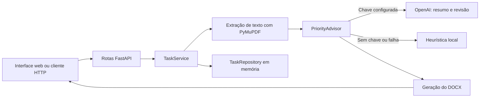

# Micro-API de resumo de PDF

Micro-API em FastAPI com interface web para receber PDFs digitais e gerar documentos Word (`.docx`). O resumo pode cobrir o PDF inteiro ou responder a uma sentença orientadora. Os metadados das tarefas ficam em memória. A aplicação usa a OpenAI quando configurada e mantém uma heurística local como fallback.

## Requisitos

- Python 3.12 ou superior.
- `pip`.
- GNU Make opcional, para usar os atalhos do `Makefile`.
- Chave da OpenAI opcional. Sem ela, a aplicação usa o resumo local.

As dependências em `requirements.txt` não estão fixadas em versões. Uma instalação limpa instala as versões disponíveis no momento; portanto, isso não garante reproduzir exatamente o mesmo ambiente em outra data.

## Instalação e execução

Crie um ambiente virtual na raiz do projeto.

**Windows PowerShell:**

```powershell
py -3.12 -m venv .venv
.\.venv\Scripts\Activate.ps1
```

**Linux ou macOS:**

```bash
python3.12 -m venv .venv
source .venv/bin/activate
```

Instale as dependências de execução:

```bash
python -m pip install --upgrade pip
python -m pip install -r requirements.txt
```

Inicie a API com recarga automática:

```bash
python -m uvicorn app.main:app --reload
```

A interface fica em <http://127.0.0.1:8000/>. A documentação interativa da API fica em `/docs`, e o endpoint de saúde fica em `/health`.

Se GNU Make estiver instalado, os atalhos equivalentes são `make install`, `make run` e `make test`. No Windows sem Make, use os comandos Python documentados neste README.

## Configuração da OpenAI

A integração é opcional. Copie `.env.example` para `.env` e substitua o valor de `OPENAI_API_KEY` por uma chave válida. O arquivo `.env` é carregado ao iniciar a aplicação e está excluído do Git. Nunca coloque uma chave real no `.env.example` nem a envie em commits.

**Windows PowerShell:**

```powershell
Copy-Item .env.example .env
```

**Linux ou macOS:**

```bash
cp .env.example .env
```

| Variável | Padrão no código | Descrição |
| --- | --- | --- |
| `OPENAI_API_KEY` | vazio | Habilita chamadas à API da OpenAI. |
| `OPENAI_MODEL` | `gpt-4o-mini` | Modelo usado para resumir e revisar. |
| `OPENAI_TIMEOUT_SECONDS` | `20` | Timeout em segundos, limitado pelo código ao intervalo de 1 a 120. |

## Como usar a interface

1. Selecione um PDF digital com camada de texto.
2. Escolha **Por sentença orientadora** ou **Do PDF inteiro**.
3. No modo orientado, informe uma sentença que apareça no PDF.
4. Clique em **Gerar resumo em Word** para baixar o `.docx`.

No modo orientado, a busca ignora diferenças entre maiúsculas e minúsculas e espaços repetidos. Se a sentença não for encontrada, a API responde com erro `422` e não gera o documento.

## Exemplos de uso da API

A criação recebe `multipart/form-data`. Em sucesso, `POST /tasks` retorna `201`, o DOCX no corpo, o nome do arquivo em `Content-Disposition` e o identificador da tarefa em `X-Task-ID`. Os exemplos usam cURL; no PowerShell, chame `curl.exe` e execute cada comando em uma única linha.

**Resumo do PDF inteiro:**

```bash
curl -X POST http://127.0.0.1:8000/tasks -F "file=@documento.pdf" -F "summary_mode=whole" -D - -o resumo-inteiro.docx
```

**Resumo orientado por sentença:**

```bash
curl -X POST http://127.0.0.1:8000/tasks -F "file=@documento.pdf" -F "summary_mode=guided" -F "sentence=Qual é a conclusão principal?" -D - -o resumo-orientado.docx
```

Os cabeçalhos exibidos pelo `POST` incluem `X-Task-ID`. Liste as tarefas armazenadas em memória:

```bash
curl http://127.0.0.1:8000/tasks
```

Para consultar uma tarefa específica:

```bash
curl http://127.0.0.1:8000/tasks/ID_DA_TAREFA
```

| Operação | Resposta de sucesso | Erros comuns |
| --- | --- | --- |
| `POST /tasks` | `201` e arquivo DOCX; ID em `X-Task-ID` | `400` para arquivo inválido; `422` para sentença ausente/não encontrada ou PDF sem texto extraível |
| `GET /tasks` | `200` e lista JSON | — |
| `GET /tasks/{task_id}` | `200` e tarefa JSON | `404` se a tarefa não existir |
| `PUT /tasks/{task_id}` | `200` e tarefa atualizada | `404` se a tarefa não existir |
| `DELETE /tasks/{task_id}` | `204` sem corpo | `404` se a tarefa não existir |

## Como funciona o resumo com IA

Quando `OPENAI_API_KEY` está configurada, a aplicação extrai o texto do PDF e o envia à OpenAI. O prompt solicita uma análise estruturada com contexto, problema central, argumentos, dados e evidências, conceitos técnicos, metodologia quando identificável, conclusões, implicações práticas e ambiguidades. Também solicita citações curtas sustentadas pela fonte, resumo executivo de até 10 linhas, termos-chave e perguntas para discussão. O conteúdo do PDF é tratado como dado, e instruções encontradas dentro dele não devem ser seguidas pelo modelo.

O fluxo depende do tamanho do texto extraído:

1. Até 12.000 caracteres, o texto completo é enviado em uma chamada de resumo (*stuffing*).
2. Acima de 12.000 caracteres, o texto é dividido em trechos de até 12.000 caracteres, resumido por partes e sintetizado em uma resposta final (*map-reduce*).
3. Antes de gerar o Word, uma etapa adicional pede à OpenAI para comparar afirmações, números, condições, ressalvas e cobertura do rascunho com a fonte. Em documentos longos, essa revisão ocorre por trecho e seus resultados são consolidados.
4. O Word preserva títulos hierárquicos, listas, trechos destacados e citações reconhecidos na resposta.

Essa revisão é feita pelo próprio modelo e não constitui uma validação independente. Ela pode não detectar todos os erros; confira o resultado, especialmente em decisões legais, médicas, financeiras ou acadêmicas.

Se a chave estiver ausente ou uma chamada externa falhar, a heurística local assume como fallback. O fallback seleciona trechos do texto e não produz necessariamente a mesma análise estruturada da OpenAI. Em textos extraídos muito curtos, a aplicação evita inferir um assunto sem evidência suficiente.

O texto extraído e enviado ao provedor pode conter dados pessoais ou confidenciais. Avalie as regras de privacidade, retenção e uso de dados aplicáveis antes de processar esses documentos. Chamadas de resumo e de revisão podem gerar custos na conta da API.

## Arquitetura e fluxo da requisição



| Caminho | Responsabilidade |
| --- | --- |
| `app/main.py` | Configura FastAPI, carrega `.env`, registra rotas e serve a interface. |
| `app/api/task_routes.py` | Valida o upload e os parâmetros, chama o serviço e define respostas HTTP. |
| `app/services/task_service.py` | Extrai o texto, aplica as regras de negócio, coordena o resumo e cria o Word. |
| `app/services/priority_advisor.py` | Cria o resumo via OpenAI ou heurística local e executa a revisão semântica quando a API está disponível. |
| `app/repositories/task_repository.py` | Mantém metadados de tarefas em memória. |
| `app/models/task.py` | Define os modelos e validações dos dados da tarefa. |
| `app/static/index.html` | Implementa a interface web. |

## Testes

Instale as dependências de execução e as dependências de teste:

```bash
python -m pip install -r requirements.txt
python -m pip install pytest httpx
```

Execute a suíte:

```bash
python -m pytest
```

Ou use `make test` com GNU Make instalado. Os testes usam dependências simuladas para a integração externa; executar a suíte não exige uma chave OpenAI válida nem deve fazer chamadas pagas.

## Limitações e solução de problemas

- PDFs digitalizados sem camada de texto não são processados; OCR não está implementado.
- O upload e o processamento são síncronos, sem limite explícito de tamanho de arquivo.
- A revisão semântica feita por LLM pode deixar passar imprecisões; valide o DOCX para usos de alto impacto.
- O fallback local é extrativo e pode selecionar trechos pouco relevantes.
- Tarefas e contadores de nomes ficam em memória e são reiniciados quando o servidor reinicia.
- A API não tem autenticação, autorização nem persistência de tarefas.
- Se `/health` responder, mas a criação falhar com `422`, verifique se o PDF contém texto selecionável e se a sentença orientadora aparece literalmente no texto extraído.
- Se a integração da OpenAI não for usada, confira se `OPENAI_API_KEY` está definida no `.env` e reinicie o servidor após alterá-la.

## Funcionalidades futuras com PDFs

As ideias abaixo podem ampliar a aplicação para além da geração de resumos. São possibilidades de implementação futura e ainda não estão disponíveis:

- **Converter PDF em Word (`.docx`):** extrair texto, títulos, tabelas e imagens, preservando o máximo possível da formatação original.
- **Converter PDF em Excel (`.xlsx`):** detectar tabelas e organizar seu conteúdo em planilhas editáveis, com uma tabela por aba quando apropriado.
- **OCR para PDFs digitalizados:** reconhecer texto em páginas que contenham apenas imagens, habilitando resumo, busca e conversão desses arquivos.
- **Extrair tabelas e imagens:** permitir baixar elementos selecionados do PDF em formatos reutilizáveis.
- **Converter PDF em texto ou Markdown:** gerar arquivos simples e estruturados para edição, pesquisa ou uso em outras ferramentas.
- **Unir, dividir e reorganizar PDFs:** combinar arquivos, extrair intervalos de páginas ou alterar a ordem das páginas.
- **Pesquisar e responder perguntas sobre o documento:** localizar informações e apresentar respostas com referências às páginas de origem.
- **Traduzir o conteúdo:** gerar uma cópia traduzida ou exportar a tradução para Word.

Conversões de documentos podem alterar o layout, especialmente em PDFs com colunas, tabelas complexas, fontes incomuns ou digitalizações. Uma futura implementação deve indicar limitações e permitir conferir o resultado antes de utilizá-lo.
